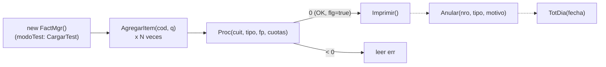
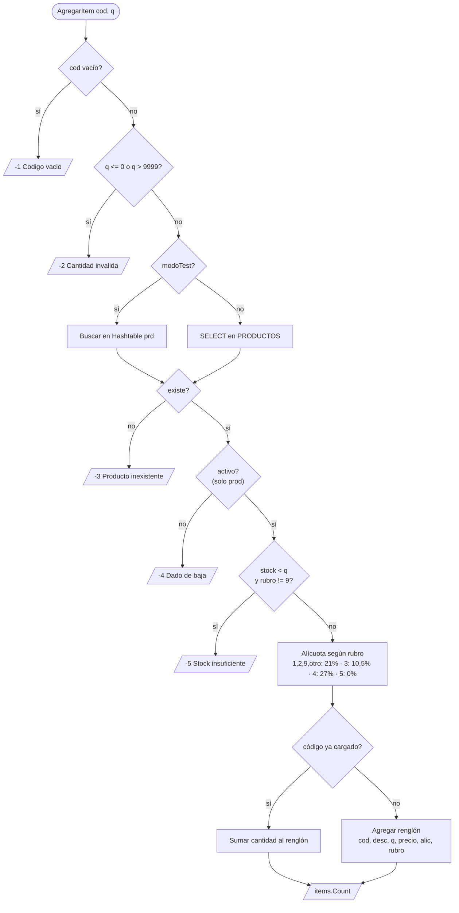
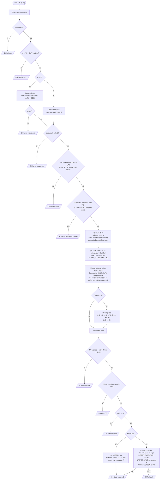

# SistFact: reglas de negocio inferidas de `FactMgr.cs`

> Documento generado leyendo `src/SistFact.Negocio/FactMgr.cs` (commit `768fa10`), sin modificar el código.
> Los números de línea refieren a ese archivo.
> Lo que no se puede deducir con certeza del código está marcado como **SUPUESTO**.
> Las inconsistencias o comportamientos dudosos están marcados como **OBSERVACIÓN**. Solo se documentan; no se corrigen.

---

## 1. Resumen del sistema

`FactMgr` es una única clase que arma, valida, calcula, persiste, imprime y anula **facturas de venta** al estilo argentino (CUIT, condición frente al IVA, Factura A/B, percepciones de IIBB por provincia).

Cada instancia de `FactMgr` representa **una factura en construcción**. El uso típico es:

1. `new FactMgr()`: si `modoTest` es `true`, carga productos y clientes de ejemplo en memoria (`CargarTest`, L639).
2. `AgregarItem(cod, cantidad)` una o más veces (L49): valida el producto y el stock, y determina la alícuota de IVA.
3. `Proc(cuit, tipo, formaPago, cuotas)` (L165): valida cliente y comprobante, calcula descuentos, impuestos y recargos, y graba la factura. Devuelve `0` si sale bien o un código negativo si falla (el mensaje queda en `err`).
4. `Imprimir()` (L450): devuelve el texto de la factura (solo si `Proc` terminó bien, `flg == true`).

Operaciones adicionales:

- `Anular(nro, tipo, motivo)` (L510): anula un comprobante y repone el stock.
- `TotDia(fecha)` (L606): suma lo facturado (no anulado) en un día.
- `Valid(cuit)` (L145): valida un CUIT.
- `Recalc()` (L434): recalcula un subtotal; solo lo usa `Imprimir`.

Tiene dos modos:

- **Modo test** (`modoTest = true`): productos y clientes en `Hashtable` en memoria. Las facturas se guardan en la lista estática `hist`.
- **Modo producción**: SQL Server (`cs`, L12) con las tablas `PRODUCTOS`, `CLIENTES`, `FACTURAS` y `FACTURAS_ITEMS`.

---

## 2. Reglas de negocio

### 2.1 Alta de ítems: `AgregarItem` (L49–143)

| # | Regla | Línea | Código de retorno |
|---|-------|-------|-------------------|
| I1 | El código de producto no puede ser nulo ni vacío. | L51–55 | `-1` "Codigo vacio" |
| I2 | La cantidad debe ser `> 0`. | L56–60 | `-2` "Cantidad invalida" |
| I3 | La cantidad no puede superar `9999`. | L61–65 | `-2` "Cantidad invalida" |
| I4 | El código se normaliza con `Trim().ToUpper()` antes de buscarlo. | L74, L79, L91 | |
| I5 | El producto debe existir. | L74–78 (test), L93–98 (prod) | `-3` "Producto inexistente" |
| I6 | El producto debe estar activo (`ACTIVO <> 0`). **Solo en producción**: el array de prueba no tiene ese dato. | L99–104 | `-4` "Producto dado de baja" |
| I7 | Error de base de datos al buscar el producto. | L111–115 | `-99` |
| I8 | **Control de stock**: si `stock < cantidad` se rechaza, **excepto para el rubro 9**, que no controla stock. | L121–125 | `-5` "Stock insuficiente" |
| I9 | **Alícuota de IVA según el rubro** (ver tabla 2.2). | L126–131 | |
| I10 | Si el código ya está en la factura, **se suma la cantidad** a ese renglón en lugar de crear otro. | L132–140 | devuelve la cantidad de renglones |
| I11 | Si sale bien, devuelve la cantidad de renglones (`items.Count`, siempre > 0). | L141–142 | |

**OBSERVACIÓN (I10):** al sumar cantidades a un renglón existente no se vuelve a validar el stock contra la cantidad acumulada ni el tope de 9999. Por ejemplo, dos veces 30 unidades con stock 40 se aceptan.

### 2.2 Rubros e IVA

| Rubro | Alícuota IVA (L126–131) | Otras reglas asociadas | Significado (SUPUESTO, deducido de los productos de prueba L645–650) |
|-------|-------------------------|------------------------|-------------------------------------------------------------------|
| 1 | 21% | | Librería/papelería (Resma A4) |
| 2 | 21% | | Insumos de informática (Tóner) |
| 3 | 10,5% | | Libros |
| 4 | 27% | Paga **impuestos internos 8%** (L306, L340) | Bebidas (energizante) |
| 5 | 0% (exento) | **No recibe descuento por volumen** (L300) | Alimentos de primera necesidad (leche) |
| 9 | 21% | **No controla stock** (L121), no descuenta stock (L380, L406) y no lo repone al anular (L541, L584) | Servicios (servicio técnico) |
| otro | 21% (default) | | SUPUESTO: cualquier rubro no contemplado se trata como gravado general |

### 2.3 Validación de CUIT: `Valid` (L145–163)

| # | Regla | Línea |
|---|-------|-------|
| C1 | `null` es inválido. | L147 |
| C2 | Se quitan guiones y espacios antes de validar. | L148 |
| C3 | Debe tener exactamente 11 caracteres, todos dígitos. | L149–151 |
| C4 | Prefijos permitidos: `20, 23, 24, 27` (SUPUESTO: personas físicas) y `30, 33, 34` (SUPUESTO: personas jurídicas). | L152–153 |
| C5 | Dígito verificador módulo 11 con multiplicadores `5,4,3,2,7,6,5,4,3,2`. `v = 11 - (suma % 11)`; si `v == 11` entonces `0`; **si `v == 10` entonces `9`**. | L154–161 |

**OBSERVACIÓN (C5):** el caso `v == 10 → 9` no coincide con el algoritmo oficial de AFIP, donde un resultado de 10 implica cambiar el prefijo (23/33) y no reemplazar el dígito. **SUPUESTO**: es un atajo heredado; no se puede saber si es intencional.

### 2.4 Procesamiento de la factura: `Proc` (L165–432)

#### Parámetros

- `c`: CUIT del cliente. `"0"` = consumidor final sin identificar.
- `t`: tipo de comprobante. `1` = Factura A, `6` = Factura B (deducido de `Imprimir`, L455–456, y coincide con los códigos AFIP).
- `f`: forma de pago (`EF` efectivo, `TC` tarjeta de crédito, `TD` tarjeta de débito, `CC` cuenta corriente, `CH` cheque; L468–472).
- `cq`: cantidad de cuotas.

#### Validaciones previas al cálculo (en este orden)

| # | Regla | Línea | Retorno |
|---|-------|-------|---------|
| P1 | Se reinician todos los acumuladores y `err`. | L167–168 | |
| P2 | La factura debe tener al menos un ítem. | L169–173 | `-1` |
| P3 | El CUIT se normaliza (guiones/espacios) y debe ser válido, salvo que sea `"0"`. | L174–180 | `-2` |
| P4 | **Consumidor final** (`"0"`): razón social `CONSUMIDOR FINAL`, provincia `BA`, categoría `1`, condición IVA `5`, saldo y límite `0`, no bloqueado. | L188–194 | |
| P5 | El cliente identificado debe existir (test: Hashtable; prod: tabla `CLIENTES`, con caché estática por CUIT). | L195–250 | `-3` (`-99` si falla la base) |
| P6 | **Cliente bloqueado** (`bq == 1`) no puede facturar, salvo que `flg2` esté activo. | L251–255 | `-4` |
| P7 | **Factura A solo para Responsables Inscriptos** (`cond == 1`). | L256–260 | `-5` |
| P8 | **Un Responsable Inscripto debe recibir Factura A**, no B. | L261–265 | `-5` |
| P9 | Solo están habilitados los tipos `1` (A) y `6` (B). | L266–270 | `-5` |
| P10 | La forma de pago debe ser `EF`, `TC`, `TD`, `CC` o `CH` (se normaliza con `ToUpper().Trim()`, L183). | L271–275 | `-6` |
| P11 | **Solo la tarjeta de crédito admite más de 1 cuota.** | L276–280 | `-6` |
| P12 | Las cuotas deben estar entre 1 y 12, para cualquier forma de pago. | L281–285 | `-6` |
| P13 | **Cuenta corriente requiere un cliente identificado** (no `"0"`). | L286–290 | `-6` |

**OBSERVACIÓN (P7–P9):** P7 y P8 se evalúan antes que P9. Un tipo inválido (por ejemplo `t = 2`) con un cliente RI no cae en P7 ni en P8 y termina en P9. Con un cliente no RI y `t = 2`, también termina en P9. El mensaje de error final es correcto en ambos casos.

#### Cálculo de subtotales y descuento por volumen (L291–312)

| # | Regla | Línea |
|---|-------|-------|
| D1 | Importe del renglón = cantidad × precio unitario. | L299 |
| D2 | **Descuento por volumen por renglón** (no aplica al rubro 5): cantidad ≥ 100 → 10%; ≥ 50 → 5%; ≥ 10 → 2%. Los tramos no se acumulan, se aplica el mayor. | L300–305 |
| D3 | Se acumulan bases imponibles por alícuota: `b1` (21%), `b2` (10,5%), `b3` (27%), `b0` (exento / otras). | L307–310 |
| D4 | Se acumula aparte la base de **impuestos internos** `b4` (rubro 4). | L306 |
| D5 | `tot` = suma de renglones con el descuento por volumen aplicado (sin redondear). | L311 |

#### Descuento general (bonificación) (L313–328)

Los porcentajes **se suman** en `pd`:

| # | Regla | Línea |
|---|-------|-------|
| B1 | Por **categoría de cliente**: cat 2 → 3%; cat 3 → 5%; cat 4 → **8% si `tot` ≤ 50.000, 5% si `tot` > 50.000**; cat 1 u otra → 0%. | L314–320 |
| B2 | **Pago en efectivo** con `tot` > 100 → +5%. | L321 |
| B3 | **Pago con tarjeta de débito** → +2%. | L322 |
| B4 | **Los miércoles**, clientes de categoría ≥ 2 → +2%. Usa la fecha del servidor (`DateTime.Now`). | L323 |
| B5 | **Promoción navideña**: del 15 al 24 de diciembre inclusive → +3% para todos. | L324 |
| B6 | **Tope de descuento del 15%**, salvo que `flg2` esté activo. | L325 |
| B7 | `d1` (bonificación) = `round(tot × pd, 2)`; `tot2` (neto) = `tot − d1`. | L326–327 |

**OBSERVACIÓN (B1):** en la categoría 4, a mayor monto le corresponde **menos** descuento (8% → 5%). Es contraintuitivo. **SUPUESTO**: podría ser un error de inversión del `if`, o una regla real para limitar el descuento en compras grandes. No se puede saber con el código.

**SUPUESTO (categorías):** el código no define qué significa cada categoría de cliente. Por el descuento creciente, parecería algo como 1 = minorista/general, 2 y 3 = clientes con bonificación, 4 = mayorista/especial.

#### Impuestos (L328–341)

| # | Regla | Línea |
|---|-------|-------|
| T1 | El IVA se calcula sobre la base **ya bonificada**: `base × (1 − pd) × alícuota`, redondeado a 2 decimales por alícuota (21%, 10,5%, 27%). | L328–331 |
| T2 | **Percepción de IIBB, solo en Factura A**, sobre el neto `tot2`: | L332–339 |
| | • `BA` (Buenos Aires): 3%, solo si `tot2` > 3.000 | L334 |
| | • `CABA`: 2,5% | L335 |
| | • `CBA` (Córdoba): 1,5%, solo si la categoría del cliente ≠ 1 | L336 |
| | • `SF` (Santa Fe): 1,8% | L337 |
| | • Otras provincias: 0% | |
| T3 | **Impuestos internos**: 8% sobre `b4` (rubro 4), redondeado. | L340 |
| T4 | `tot3` (total) = neto + IVA 21 + IVA 10,5 + IVA 27 + percepción + impuestos internos. | L341 |

**OBSERVACIÓN (T3):** los impuestos internos se calculan sobre `b4` **sin aplicar la bonificación `pd`**, a diferencia del IVA (T1).

**OBSERVACIÓN (T2):** la percepción se calcula sobre `tot2`, que incluye la base exenta (`b0`). **SUPUESTO**: no se sabe si la norma que se quiso modelar excluye lo exento.

**OBSERVACIÓN (T1):** las comparaciones de alícuota usan igualdad exacta de `double` (`a == 0.21`, L307–309). Hoy funcionan porque los valores salen de los mismos literales (L126–131).

#### Recargo financiero por cuotas (L342–349)

| # | Regla | Línea |
|---|-------|-------|
| R1 | Solo con tarjeta de crédito y más de 1 cuota. | L342 |
| R2 | 2 a 3 cuotas → 6% sobre `tot3`. | L344 |
| R3 | 4 a 6 cuotas → 12%. | L345 |
| R4 | 7 a 12 cuotas → **1,8% × cantidad de cuotas** (7 → 12,6%; 12 → 21,6%). | L346 |
| R5 | El recargo `d2` se redondea y se suma al total. El recargo se aplica **sobre el total con impuestos**. | L347–348 |
| R6 | El total final se redondea a 2 decimales. | L350 |

#### Validaciones posteriores al cálculo

| # | Regla | Línea | Retorno |
|---|-------|-------|---------|
| V1 | **Límite de crédito**: en cuenta corriente, `saldo + total` no puede superar el `límite`, salvo que `flg2` esté activo. | L351–355 | `-8` |
| V2 | **Consumidor final sin identificar**: el total no puede superar $1.000. | L356–360 | `-9` |
| V3 | El total debe ser > 0. | L361–365 | `-10` |

**OBSERVACIÓN:** no existe el código de retorno `-7`. **SUPUESTO**: una regla que se eliminó.

#### Persistencia

| # | Regla | Línea |
|---|-------|-------|
| G1 | **Numeración en test**: `1000 + contador estático global`, compartido entre tipos A y B. | L368–369 |
| G2 | **Numeración en producción**: `MAX(NRO) + 1` **por tipo de comprobante**, dentro de una transacción. | L391–392 |
| G3 | Se registra la factura (cabecera) y sus ítems. | L370, L393–405 |
| G4 | **Descuento de stock** por ítem, excepto rubro 9. | L380, L406–410 |
| G5 | Si la forma de pago es **cuenta corriente, se suma el total al saldo del cliente**. | L371–375, L412–416 |
| G6 | En producción todo va en una transacción; si algo falla se hace rollback y se devuelve `-99`. | L390, L417, L420–426 |
| G7 | Si sale bien, `flg = true` habilita `Imprimir`. | L382, L418 |

**OBSERVACIÓN (G4):** en modo test el stock se descuenta con `(int)cantidad`, que trunca los decimales (L380). En producción se descuenta la cantidad tal cual (L408).

**OBSERVACIÓN (G1/G2):** la numeración difiere entre modos (global en test, por tipo en producción).

### 2.5 Banderas `flg` y `flg2`

- `flg` (L39): indica que la factura se procesó correctamente. `Imprimir` devuelve `""` si es `false` (L452).
- `flg2` (L40): **SUPUESTO**: autorización especial (supervisor/gerencia). Cuando es `true`:
  - permite facturar a clientes bloqueados (L251);
  - elimina el tope del 15% de descuento (L325);
  - permite superar el límite de crédito (L351).

  No se asigna en ningún lugar de `FactMgr`; es un campo público que debe setear quien llama. La consola no lo usa.

### 2.6 Impresión: `Imprimir` (L450–508)

| # | Regla | Línea |
|---|-------|-------|
| M1 | Solo imprime si la factura fue procesada (`flg`). | L452 |
| M2 | Letra: tipo 1 → `A`, tipo 6 → `B`, otro → `?`. | L455–457 |
| M3 | Punto de venta fijo `0001`; número con 8 dígitos. | L459 |
| M4 | La fecha impresa es la fecha actual, no la de emisión. | L460 |
| M5 | El CUIT se muestra con formato `XX-XXXXXXXX-X`, salvo para consumidor final. | L463 |
| M6 | Condición IVA: 1 = Responsable Inscripto, 4 = Exento, 6 = Monotributo, cualquier otro = Consumidor Final. | L464 |
| M7 | **En Factura B los precios unitarios se muestran con IVA incluido** (`pu × (1 + alícuota)`). | L481 |
| M8 | **Factura A** discrimina subtotal, bonificación, neto, cada IVA, percepción e impuestos internos. | L488–498 |
| M9 | **Factura B** muestra solo la bonificación (`d1 × 1,21`), los impuestos internos, el recargo y el total. | L499–505 |
| M10 | La descripción del ítem se trunca a 22 caracteres. | L484 |

**OBSERVACIÓN (M8):** el "Subtotal" de la Factura A sale de `Recalc()` (L434–448), que **aplica descuento por volumen también al rubro 5** y **redondea por renglón**. `Proc` no hace ninguna de las dos cosas. Por eso el subtotal impreso puede no coincidir con `tot`, y entonces Subtotal − Bonificación ≠ Neto.

**OBSERVACIÓN (M9):** la bonificación de la Factura B se "lleva a final" multiplicando por 1,21 aunque haya ítems al 10,5%, 27% o exentos.

**OBSERVACIÓN (M8):** la etiqueta "Neto gravado" muestra `tot2`, que incluye importes exentos.

### 2.7 Anulación: `Anular` (L510–604)

| # | Regla | Línea | Resultado |
|---|-------|-------|-----------|
| A1 | El motivo es obligatorio y debe tener **al menos 10 caracteres** (sin contar espacios al borde). | L513–517 | `false` |
| A2 | El comprobante (número + tipo) debe existir. | L520–547, L555–560 | `false` "Comprobante inexistente" |
| A3 | No puede estar ya anulado. | L525–529, L567–571 | `false` |
| A4 | **Solo se pueden anular comprobantes de hasta 15 días de antigüedad.** | L530–534, L572–576 | `false` |
| A5 | Se marca como anulada (en producción también se guarda el motivo). | L535, L577 | |
| A6 | **Se repone el stock** de los ítems, excepto rubro 9. | L537–542, L579–586 | |
| A7 | En producción, si se pagó en cuenta corriente **se resta el total del saldo del cliente** y se invalida la caché de ese cliente. | L587–592 | |

**OBSERVACIÓN (A7):** en **modo test no se revierte el saldo de cuenta corriente** al anular. Es una diferencia de comportamiento entre modos.

**OBSERVACIÓN (A5/A6):** en producción la anulación **no usa transacción** (a diferencia de `Proc`). Un fallo a mitad de camino deja la factura anulada con el stock o el saldo a medio revertir.

### 2.8 Total del día: `TotDia` (L606–637)

| # | Regla | Línea |
|---|-------|-------|
| TD1 | Suma el total de los comprobantes de la fecha indicada **que no estén anulados**, sumando A y B por igual. | L611–618, L625 |
| TD2 | En producción, si hay error devuelve `-1`. | L628–631 |

**OBSERVACIÓN (TD1):** en test hay un `if` por tipo cuyas dos ramas hacen lo mismo (L615–616). **SUPUESTO**: restos de una regla anterior que distinguía tipos.

---

## 3. Estructura de los arrays `object[]`

### 3.1 Producto (datos de prueba, `h["prd"]`, L645–650; leído en L79–83)

Clave del `Hashtable`: código de producto en mayúsculas (`"P001"`).

| Posición | Tipo | Significado | Evidencia |
|----------|------|-------------|-----------|
| `[0]` | `string` | Descripción | L80 `desc = (string)o[0]`; equivale a la columna `DESCRIP` (L105) |
| `[1]` | `double` | Precio unitario | L81; columna `PRECIO` (L106) |
| `[2]` | `int` | Rubro (ver 2.2) | L82; columna `RUBRO` (L107) |
| `[3]` | `int` | Stock disponible (mutable: se descuenta al facturar y se repone al anular) | L83, L380, L541; columna `STOCK` (L108) |

- No existe posición para `ACTIVO`: en modo test todos los productos se consideran activos.
- **SUPUESTO**: el precio es **neto, sin IVA**. Se deduce porque el IVA se suma después (L329–331) y porque la Factura B lo muestra multiplicado por `(1 + alícuota)` (L481).

### 3.2 Cliente (datos de prueba, `h["cli"]`, L653–655; leído en L203–210)

Clave del `Hashtable`: CUIT de 11 dígitos sin guiones.

| Posición | Tipo | Significado | Evidencia |
|----------|------|-------------|-----------|
| `[0]` | `string` | Razón social | L204; columna `RAZON` (L243) |
| `[1]` | `string` | Provincia (código: `BA`, `CABA`, `CBA`, `SF`, …) | L205, L334–337; columna `PROV` |
| `[2]` | `int` | Categoría de cliente (1–4, define la bonificación) | L206, L314–320; columna `CATEG` |
| `[3]` | `int` | Condición frente al IVA: 1 = RI, 4 = Exento, 5 = Consumidor Final (**SUPUESTO**, por L193 y por el código AFIP), 6 = Monotributo | L207, L464; columna `COND_IVA` |
| `[4]` | `double` | Saldo de cuenta corriente (mutable: aumenta al facturar en CC) | L208, L374; columna `SALDO` |
| `[5]` | `double` | Límite de crédito en cuenta corriente | L209, L351; columna `LIMITE` |
| `[6]` | `int` | Bloqueado (1 = sí, 0 = no) | L210, L251; columna `BLOQ` |

### 3.3 Ítem de factura (`items`, creado en L141)

| Posición | Tipo | Significado | Evidencia |
|----------|------|-------------|-----------|
| `[0]` | `string` | Código de producto (mayúsculas) | L141; columna `COD` en `FACTURAS_ITEMS` (L403) |
| `[1]` | `string` | Descripción | `DESCRIP` |
| `[2]` | `double` | Cantidad (se acumula si el código se repite, L137) | `CANT` |
| `[3]` | `double` | Precio unitario (neto, **SUPUESTO**, ver 3.1) | `PRECIO` |
| `[4]` | `double` | Alícuota de IVA (0,21 / 0,105 / 0,27 / 0) | `ALIC` |
| `[5]` | `int` | Rubro (no se persiste en `FACTURAS_ITEMS`) | L298, L380, L406 |

### 3.4 Historial de facturas en modo test (`hist`, creado en L370)

| Posición | Tipo | Significado | Evidencia |
|----------|------|-------------|-----------|
| `[0]` | `int` | Número de comprobante | L369–370, L523 |
| `[1]` | `DateTime` | Fecha y hora de emisión | L530, L613 |
| `[2]` | `double` | Total (`tot3`) | L615–616 |
| `[3]` | `int` | Tipo de comprobante (1 / 6) | L523 |
| `[4]` | `string` | CUIT del cliente | Se guarda pero no se lee en ningún lugar |
| `[5]` | `bool` | Anulada | L525, L535, L613 |
| `[6]` | `ArrayList` | Ítems de la factura (la **misma referencia** que `items` de la instancia, no una copia) | L536 |

**OBSERVACIÓN (3.4 `[6]`):** al guardarse por referencia, si se sigue usando la instancia de `FactMgr` después de `Proc` (por ejemplo, agregando ítems), el historial cambia también.

---

## 4. Diagrama del flujo principal de facturación

### 4.1 Ciclo de vida de una factura

### 4.2 `AgregarItem`

### 4.3 `Proc` (flujo principal)

---

## 5. Resumen de supuestos

| Tema | Supuesto |
|------|----------|
| Significado de rubros 1–5 y 9 | Inferido de las descripciones de los productos de prueba. |
| Significado de las categorías de cliente 1–4 | No hay evidencia; solo se sabe el descuento que reciben. |
| Condición IVA 5 = Consumidor Final | Inferido del alta del consumidor final (L193) y de los códigos AFIP; `Imprimir` lo muestra como "Consumidor Final" por defecto. |
| Precio unitario neto, sin IVA | Inferido del cálculo de IVA y de la impresión de la Factura B. |
| `flg2` = autorización especial | Inferido de las tres reglas que relaja; nada en el código lo nombra. |
| Prefijos CUIT (personas físicas vs jurídicas) | Conocimiento del dominio, no del código. |
| Regla `v == 10 → 9` del dígito verificador | No se sabe si es intencional. |
| Código de retorno `-7` ausente | Posible regla eliminada. |
| Descuento de la categoría 4 invertido | No se sabe si es un bug o una regla real. |
